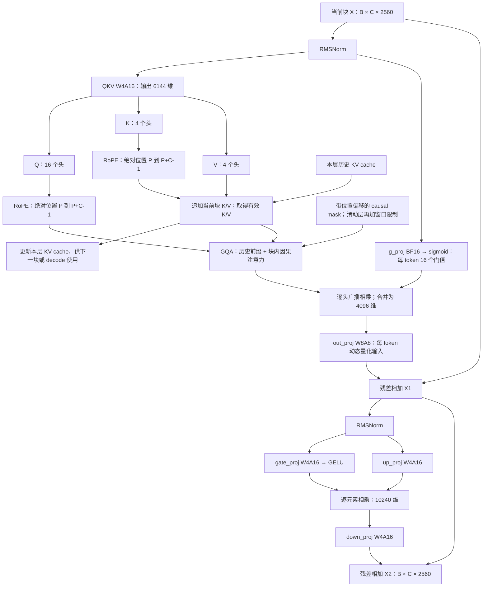
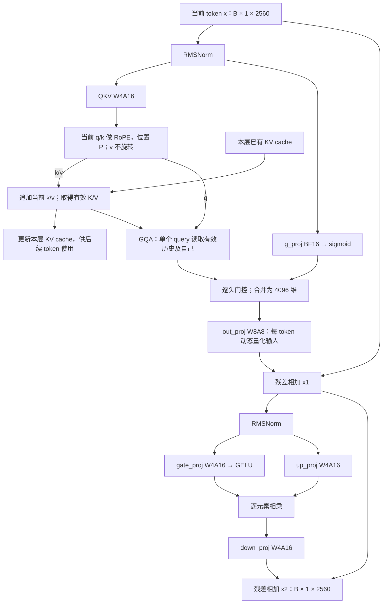
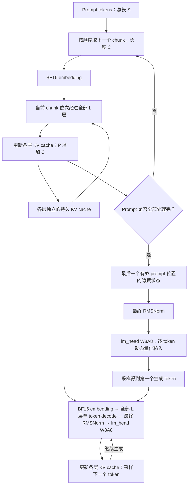

# 模型量化与推理流程：Decode / Chunked Prefill

本文汇总本次讨论的模型量化配置、单 token decode 和 chunked prefill 的计算流程。**Prefill 以分块处理 prompt 为基准**；每个 chunk 读取前面各块建立的 KV cache，并在块内使用因果注意力。

量化表和主流程中的 `W4A16`、`W8A8` 按讨论中给定的原始模型方案表示。它们与仓库默认转换后的 MLX 执行方式存在差别，见[与当前仓库实现的对应关系](#7-与当前仓库实现的对应关系)。本文记录计算逻辑，不修改模型实现或运行配置。

## 1. 符号与模型维度

| 符号 | 含义 | 本模型取值或约定 |
| --- | --- | --- |
| `B` | Batch size | 按请求确定 |
| `S` | 完整 prompt 的 token 数 | 按请求确定 |
| `C` | 当前 prefill chunk 的实际 token 数 | 最后一块可以小于设定的 chunk size |
| `P` | 当前调用前，已经处理的 token 数 | 绝对位置偏移；不等于滑动缓存的物理长度 |
| `L` | Decoder 层数 | 以模型 `config.json` 为准 |
| `D` | Hidden size | `2560` |
| `I` | MLP intermediate size | `10240` |
| `Hq` | Query / attention output 头数 | `16` |
| `Hkv` | Key / value 头数 | `4` |
| `dh` | 每个头的维度 | `256` |
| `W` | Sliding-attention 的窗口宽度 | 以模型配置为准，包含当前位置 |

根据给定权重形状及仓库的逐头门控结构，可以得到：

```text
g_proj 的输出维度 = Hq = 16
out_proj 的输入维度 = Hq × dh = 4096  →  dh = 256
QKV 的输出维度 = Q + K + V = 6144
Q = 4096，K = V = (6144 - 4096) / 2 = 1024
Hkv = 1024 / 256 = 4
GQA 分组比 = Hq / Hkv = 4
```

因此 4 个 query 头共享一个 KV 头。KV cache 按 4 个 KV 头保存，无须为了 16 个 query 头在存储中复制 4 份。

后文注意力内部统一使用 `[B, H, token数, dh]` 布局，线性层输入使用 `[B, token数, 特征数]`。这些是逻辑形状，不要求内核采用相同的物理布局。为便于阅读，主流程假设 batch 中序列长度相同且没有 padding；实际变长 batch 还需要各序列的位置及有效长度信息。

## 2. 原始模型的量化方式

权重矩阵形状采用 `[输出维度, 输入维度]`。

| 权重 | 原始矩阵形状 | 权重量化方式 | 实际权重 scale 类型 | 对应计算方式 |
| --- | --- | --- | --- | --- |
| `self_attn.q_k_v_proj` | `[6144, 2560]` | INT4，非对称，group size = 32 | BF16 | W4A16 |
| `mlp.gate_proj` | `[10240, 2560]` | INT4，非对称，group size = 32 | BF16 | W4A16 |
| `mlp.up_proj` | `[10240, 2560]` | INT4，非对称，group size = 32 | BF16 | W4A16 |
| `mlp.down_proj` | `[2560, 10240]` | INT4，非对称，group size = 32 | BF16 | W4A16 |
| `self_attn.out_proj` | `[2560, 4096]` | INT8，对称，每输出通道一个 scale | FP32 | W8A8，输入按 token 动态量化 |
| `lm_head` | `[131072, 2560]` | INT8，对称，每词表行一个 scale | FP32 | W8A8，输入按 token 动态量化 |
| `self_attn.g_proj` | `[16, 2560]` | 保留 BF16 | 无 | 浮点线性投影 |
| `model.embedding` | `[131072, 2560]` | 保留 BF16 | 无 | 查表，输出 BF16 |
| RMSNorm | `[2560]` | 保留 BF16 | 无 | FP32 中间计算，再转换到输出类型 |

### 2.1 W4A16：分组权重量化，激活保留 BF16

每个输出行沿输入维度每 32 个权重分为一组。以常见的整数零点记法，逻辑反量化为：

$$
\widehat W_{n,k}
=s_{n,\lfloor k/32\rfloor}
\left(q_{n,k}-z_{n,\lfloor k/32\rfloor}\right).
$$

`s` 为 BF16 权重 scale，`z` 为非对称量化的零点。具体打包格式可能把零点改写为 affine offset，但表示的是同类反量化关系。

| 权重 | 逻辑 scale 形状 |
| --- | --- |
| `q_k_v_proj` | `[6144, 80]` |
| `gate_proj` / `up_proj` | `[10240, 80]` |
| `down_proj` | `[2560, 320]` |

Decode 和 chunked prefill 均使用这组固定权重系数，不按 token 或 chunk 重新量化权重。W4A16 表示 INT4 权重、16 位浮点激活；具体采用融合反量化还是其他矩阵乘实现，以及累加精度，由后端决定。

### 2.2 W8A8：权重逐输出行量化，输入逐 token 动态量化

设线性层输入展开为 `A[M, K]`，INT8 权重为 `Qw[N, K]`，权重 scale 为 `sw[N]`。以常见的 absmax 对称激活量化为例：

$$
s^a_m=\max_k |A_{m,k}|/127,
\qquad
Q^a_{m,k}=\operatorname{clip}
\left(\operatorname{round}(A_{m,k}/s^a_m),-127,127\right),
$$

$$
Y_{m,n}\approx s^a_m s^w_n
\sum_k Q^a_{m,k}Q^w_{n,k}.
$$

全零行的 scale 保护、舍入及截断细节以实际内核为准。通常 INT8 乘法使用 INT32 累加，再应用激活和权重 scale，并转换到后续计算需要的浮点类型。

- Decode：普通单 token 调用时 `M = B`。
- Chunked prefill：当前块有 `M = B × C` 行，每行独立计算激活 scale。
- `out_proj` 的激活量化沿 `4096` 维进行；`lm_head` 沿 `2560` 维进行。
- 两个线性层根据各自输入分别计算激活 scale，不共享 scale。表中的 FP32 指权重 scale，不据此推断激活 scale 的存储类型。

**一个 chunk 中的所有 token 不共用一个激活 scale。** W8A8 只描述 `out_proj` 和 `lm_head` 的线性计算，不表示 attention 的 `QKᵀ`、softmax、`PV` 或整个残差流都使用 INT8。

### 2.3 其他精度约定

- Embedding、`g_proj`、RMSNorm 权重保留 BF16。
- RMSNorm 按 token 沿 hidden 维归一化，FP32 中间计算后转换输出，不在 chunk 的 token 维之间归一化。
- 逐头门控为 `sigmoid(g_proj(U))`。仓库普通路径先把 BF16 投影结果转为 FP32 计算 sigmoid，再转到 attention 输出类型。
- RoPE 施加到 Q/K；V 不做 RoPE。旋转维数及 theta 按层类型的配置确定，不假设全部 `256` 维都参与旋转。
- 上述权重表未规定 KV cache 的存储类型。下文的 `K/V` 表示逻辑值；是否保存为 BF16、INT8 或其他格式，需另看缓存配置。

## 3. Chunked prefill 的计算流程

### 3.1 分块调度与缓存

把 prompt 按顺序划分为多个 chunk。每一块依次经过全部 `L` 个 decoder 层，再处理下一块；每层维护自己的 KV cache。

```text
chunk 0 → layer 0 → layer 1 → … → layer L-1
chunk 1 → layer 0 → layer 1 → … → layer L-1
chunk 2 → layer 0 → layer 1 → … → layer L-1
...
```

假设当前块之前已经处理 `P` 个 token，当前块长度为 `C`：

1. 当前块的位置编号为 `P, P+1, ..., P+C-1`。
2. 每层只对当前块计算新的 Q/K/V，不重新计算历史 token 的投影和 MLP。
3. 每层将当前块的 RoPE 后 K、以及 V，追加到本层缓存。
4. 当前块的 Q 关注本层有效历史缓存及当前块的 K/V，并受因果和窗口 mask 限制。
5. 当前块处理完毕后，已处理 token 数变为 `P+C`；下一个 chunk 继续使用这些缓存。

第一块的 `P=0`，历史缓存为空；如复用前缀缓存，第一块也可能从非零 `P` 开始。普通 chunk 边界不清空 KV cache，RoPE 的位置编号不从零重启。

### 3.2 单层伪代码

以下主流程按 full-attention 层表示。`concat` 是缓存追加的逻辑含义，不要求每块在物理内存中复制整个缓存。

```python
# X: 当前 chunk 的本层输入，[B, C, 2560]
# P: 本次调用前的绝对位置偏移，须在更新 cache 之前取得
# K_past/V_past: 本层历史缓存的逻辑值

U = RMSNorm(X)  # [B, C, 2560]

QKV = QKV_W4A16(U)  # [B, C, 6144]
Q, K, V = split(QKV, sizes=[4096, 1024, 1024])
Q = reshape_heads(Q, heads=16, head_dim=256)  # [B, 16, C, 256]
K = reshape_heads(K, heads=4, head_dim=256)  # [B,  4, C, 256]
V = reshape_heads(V, heads=4, head_dim=256)  # [B,  4, C, 256]

Qr = RoPE(Q, positions=range(P, P + C))
Kr = RoPE(K, positions=range(P, P + C))

K_all = concat(K_past, Kr, axis="tokens")  # [B, 4, P+C, 256]
V_all = concat(V_past, V, axis="tokens")  # [B, 4, P+C, 256]
KV_cache[layer] = (K_all, V_all)

mask = offset_causal_mask(query_length=C, past_length=P)
A = GQA(Qr, K_all, V_all, mask=mask)  # [B, 16, C, 256]

G = sigmoid(g_proj_BF16(U))  # [B, C, 16]
A = transpose(A, order=[0, 2, 1, 3])  # [B, C, 16, 256]
A = A * G[..., None]  # 每个头一个门值
A = reshape(A, [B, C, 4096])

# W8A8 内部对当前块的 B*C 行分别动态量化输入
X1 = X + out_proj_W8A8(A)  # [B, C, 2560]

U = RMSNorm(X1)
M = GELU(gate_proj_W4A16(U)) * up_proj_W4A16(U)  # [B, C, 10240]
X2 = X1 + down_proj_W4A16(M)  # [B, C, 2560]
```

`GQA` 使用 4 个 KV 头服务 16 个 Q 头，并包含按 `1/sqrt(256)` 缩放、mask、softmax 和对 V 加权求和。`X2` 是当前块送入下一层的输入。

### 3.3 单层流程图



### 3.4 Chunk 内的 causal mask

对 full-attention 层，以当前块内的 query 下标 `i ∈ [0,C)`、完整 K/V 序列下标 `j ∈ [0,P+C)` 表示：

$$
A=\operatorname{softmax}
\left(\frac{Q_rK_{\mathrm{all}}^\top}{\sqrt{256}}+M\right)
V_{\mathrm{all}},
\qquad
M_{i,j}=
\begin{cases}
0,&j\le P+i,\\
-\infty,&j>P+i.
\end{cases}
$$

公式按每个 Q 头及其对应的 KV 头计算。Mask 的逻辑形状为 `[C, P+C]`，可广播到 batch 和 head 维；带 padding 时还要合并有效位置 mask。

例如 `P=4, C=3`，用 `1` 表示可见、`0` 表示被屏蔽：

```text
                 历史前缀       当前块
K/V 绝对位置     0  1  2  3  |  4  5  6
Q 绝对位置 4     1  1  1  1  |  1  0  0
Q 绝对位置 5     1  1  1  1  |  1  1  0
Q 绝对位置 6     1  1  1  1  |  1  1  1
```

因此所有历史前缀可见，当前块中未来的位置不可见。不能只构造一个 `[C,C]` 的块内下三角 mask 而遗漏前缀，也不能让当前块的所有 Q 无条件关注整块 K/V。

这里的注意力分数逻辑形状为 `[B,16,C,P+C]`，不意味着必须完整物化这个张量；融合或分块 attention 内核可以避免完整保存分数矩阵。

### 3.5 Sliding-attention 层

仓库支持 `full_attention` 和 `sliding_attention`。上面的完整历史公式用于 full-attention 层；滑动层还需对每个 query 加上窗口约束：

$$
\max(0,P+i-W+1)\le j\le P+i.
$$

实际 mask 应按 K/V 的绝对位置构造。滑动层的缓存可以淘汰窗口外历史；缓存返回的 K/V 物理长度不一定为 `P+C`。处理多 token chunk 时，还必须保留或提供块内较早 query 所需的历史，不能在 attention 之前简单把所有 K/V 裁成整块末尾的最后 `W` 个 token。

**RoPE offset 始终是已经处理的绝对 token 数 `P`，不能用旋转缓存当前保留的 token 数替代。** 窗口策略改变 attention 的可见范围，不改变 QKV、门控、输出投影和 MLP 的层内顺序。

## 4. Decode 的计算流程

普通自回归 decode 每条序列一次输入一个已经生成的 token。此时本次输入长度为 1；设此前已经处理 `P` 个 token，该输入的位置为 `P`。

### 4.1 单层伪代码

```python
# x: [B, 1, 2560]
# 以下缓存形状按 full-attention 层表示

u = RMSNorm(x)
q, k, v = QKV_W4A16(u)  # 拆分并 reshape 到各自的头
qr = RoPE(q, position=P)  # [B, 16, 1, 256]
kr = RoPE(k, position=P)  # [B,  4, 1, 256]

K_all = concat(K_past, kr, axis="tokens")  # [B, 4, P+1, 256]
V_all = concat(V_past, v, axis="tokens")  # [B, 4, P+1, 256]
KV_cache[layer] = (K_all, V_all)

a = GQA(qr, K_all, V_all)  # [B, 16, 1, 256]
a = transpose(a, order=[0, 2, 1, 3])  # [B, 1, 16, 256]
a = a * sigmoid(g_proj_BF16(u))[..., None]
a = reshape(a, [B, 1, 4096])

x1 = x + out_proj_W8A8(a)  # 输入按 B 行分别动态量化
u = RMSNorm(x1)
m = GELU(gate_proj_W4A16(u)) * up_proj_W4A16(u)
x2 = x1 + down_proj_W4A16(m)
```

对于只含有效历史及当前 token 的 full-attention 缓存，唯一的 query 没有未来 token 可看，因此不需要额外的块内三角屏蔽。变长 batch、预分配缓存中的无效槽位和 sliding-attention 仍需要相应的可见范围限制。

### 4.2 单层流程图



## 5. 完整生成流程与首个生成 token



中间 prompt chunk 的主要任务是推进各层 KV cache，普通生成不需要对中间块采样。整个 prompt 处理完成后，最后一个有效位置的 logits 用于采样**第一个生成 token**；把这个生成 token 输入后续 decode，才得到第二个生成 token 的 logits。

图中最终 RMSNorm 位于 decoder 堆叠之后。由于它按 token 独立计算，在只需要最后位置 logits 时，可以只取该位置后归一化，也可以先归一化再取该位置，逻辑结果一致。是否实际只执行最后位置的 RMSNorm / `lm_head`，属于实现选择；如需 prompt logprobs，则还要保留所需位置的 logits。

在实数算术下，正确保留缓存、位置和 mask 的 chunked prefill 与一次处理完整 prompt 的注意力语义相同；不同内核和低精度舍入可能造成数值差异。Chunking 限制的是单次处理规模，不把全局 attention 改成“每块之间互不关注”的局部 attention，也不消除 full-attention 随总 prompt 长度增长的二次计算量。

## 6. Decode 与 chunked prefill 对照

下表的缓存和分数形状均按 full-attention 层、无 padding 表示；滑动层使用实际有效 KV 长度。

| 项目 | Chunked prefill | 普通单 token decode |
| --- | --- | --- |
| 本次处理的 token | 当前 prompt chunk | 当前生成 token |
| 本次序列长度 | `C`，可以为 1 | `1` |
| 本层输入 | `[B,C,2560]` | `[B,1,2560]` |
| 新 Q | `[B,16,C,256]` | `[B,16,1,256]` |
| 新 K/V | 各 `[B,4,C,256]` | 各 `[B,4,1,256]` |
| 本次调用前的缓存 | 已处理 prompt / 复用前缀的 K/V | Prompt 及已输入生成 token 的 K/V |
| Full-attention 可用 K/V | 各 `[B,4,P+C,256]` | 各 `[B,4,P+1,256]` |
| RoPE 绝对位置 | `P ... P+C-1` | `P` |
| 分数的逻辑形状 | `[B,16,C,P+C]` | `[B,16,1,P+1]` |
| 因果可见范围 | 历史前缀 + 当前块中自己及之前的位置 | 全部有效历史及自己 |
| 本次新增缓存 token 数 | 每条序列每层 `C` 个 | 每条序列每层 1 个 |
| 线性层输入展开行数 | `B×C` | `B` |
| W4A16 权重及 scale | 沿用同一套静态 INT4 / BF16 系数 | 相同 |
| W8A8 激活量化 | 对当前块的每个 token 独立计算 scale | 对当前 token 独立计算 scale |
| 线性计算形态 | 通常为多行 GEMM，取决于 `B×C` | 小 batch 时为 GEMV 或窄 GEMM |
| 生成 logits 的用途 | Prompt 最后有效位置预测第一个生成 token | 当前生成 token 预测下一个生成 token |

忽略 batch、头数和常数后，full-attention 当前 chunk 的注意力计算量约为 `O(C(P+C)dh)`，单 token decode 约为 `O((P+1)dh)`。这是注意力部分的估计，不包括 QKV、输出投影、MLP 和 `lm_head`。实际耗时还取决于硬件、chunk size、batch size、缓存格式及所选内核。

## 7. 与当前仓库实现的对应关系

主流程的 W8A8 和 FP32 权重 scale 描述的是第 2 节给定的原始量化方案。判断仓库实际执行方式时，应结合加载后的层类型、转换配置及设备能力。

| 项目 | 本文主流程约定 | 当前仓库实现 |
| --- | --- | --- |
| Decoder 结构 | RMSNorm → 门控 attention → 残差 → RMSNorm → GELU 门控 MLP → 残差 | [`model.py`](../spark_mlx_llm/model.py) 的 `Attention`、`MLP`、`TransformerBlock` 对应此结构 |
| Full / sliding attention | 按层类型使用不同可见范围 | `Spark2_5Model` 选择对应 mask，`make_cache()` 分别建立 `KVCache` / `RotatingKVCache` |
| 默认 compressed-tensors 转换 | 原始 out_proj / lm_head 为 W8A8 | 转换后保留W4/W8权重存储，QKV/MLP/out_proj的affine系数为BF16、lm_head系数保留FP32；运行时主模型自动选择native，不再写入手动路径偏好 |
| out_proj W8A8 算子 | Prefill与decode均逐token动态量化 | W8A8保留为数值/算子诊断实现，不再通过公共加载参数启用 |
| `out_proj` 的原始 FP32 scale | 按原始 scale 计算 | W8A8 适配器从已加载 affine 参数提取 scale 并转为 FP32；若转换时已舍入为 BF16，转回 FP32 不能恢复原始精度 |
| lm_head W8A8 | 本文按原始方案表示 | 当前主模型实际使用自动native路径，本文原始方案不代表默认执行路径 |
| 输入 / 输出 embedding | BF16 embedding + 独立 INT8 `lm_head` | 此配置不能直接使用同一份存储共享权重；以具体 checkpoint 的 `tie_word_embeddings` 为准，不套用 README 中其他规格模型的 tied-embedding 描述 |
| Attention 优化 | 不改变逻辑顺序 | Native QKV + RoPE、调优 BF16 SDPA 保留各自的单 token 条件；INT8-cache SDPA 另有多 token tile 内核，见下文 |

当前 `Model.__call__` 在接口上返回输入各位置的 logits；取最后一个有效位置后再做 `lm_head` 是可以表达的生成逻辑，本文流程图不表示仓库已经实现这种显式裁剪优化。

当前本地安装的 MLX LM `generate_step` 会把 prompt 前 `S-1` 个 token 按 `prefill_step_size` 分块处理，最后一个 prompt token 再单独调用模型，以取得预测第一个生成 token 的 logits。因此最终这次 prompt 调用的长度可能为 1，**输入长度为 1 不代表它已经是在处理生成 token**。具体调度随上层生成接口及 MLX LM 版本而定；第 3 节的任意 `C` 流程包含这一情况。

当前生成调度来自依赖 `mlx_lm/generate.py`，不是模型层内部自行切分。本文不固定 chunk size，也不表示 CLI 已新增对应参数。转换参数 `--chunk-rows` 只控制转换权重时分批处理的行数，与推理的 prefill chunk size 无关。

### INT8 KV cache 的分块 prefill 路径

缓存量化与权重量化相互独立。当前层使用 `QuantizedKVCache` 时，RoPE 后的新 K 及新 V 会在写入时量化；当前 chunk 的 attention 使用包含历史及当前块的量化 K/V。历史缓存保留原编码，不在每个 chunk 重新量化。

同时开启 `fused_quantized_sdpa=True` 和 `fused_quantized_sdpa_prefill=True`，且满足 INT8/G32、D256、GQA 1/2/4/8、Metal GPU、无数组 mask 的条件时，多 token 调用使用独立 tile 内核，融合读取解码、QK、在线 softmax 和 PV。两个开关默认关闭，单独开启前者仍只融合单 query。`mask="causal"` 按 `N-C+i` 处理每个 query 的可见上界；不完整物化分数或反量化 KV。其他情况仍使用 staged 量化 attention。

该内核不融合缓存写入时的量化，不实现 sliding rotating cache 的量化，也不改变上面的 chunk 调度。正确性与性能入口见[多 token INT8 attention 说明](../extensions/spark-mlx-ext/docs/sdpa_int8_prefill.md)，算子融合不表示已经测得 prefill 或完整模型提速。

## 8. 参考资料

- [仓库模型代码](../spark_mlx_llm/model.py)：GQA、逐头门控、RoPE offset、KV cache、MLP 及 W8A8 输出投影适配。
- [仓库 README](../README.md)：MLX 转换、W8A8 显式配置及后端回退说明。
- [仓库转换实现](../spark_mlx_llm/conversion.py)：原始量化到 MLX affine 的转换行为。
- [Hugging Face：How caching works](https://huggingface.co/docs/transformers/cache_explanation)：因果注意力及逐层缓存的通用语义。
- [TensorRT-LLM：Numerical Precision](https://nvidia.github.io/TensorRT-LLM/reference/precision.html)：W4A16、W8A8 和逐 token / 逐通道量化的通用术语；不作为本仓库内核实现的依据。
- [TensorRT-LLM：Attention](https://nvidia.github.io/TensorRT-LLM/advanced/gpt-attention.html)：Context / generation 阶段及融合 attention 的实现示例；不表示本仓库使用 TensorRT-LLM。
